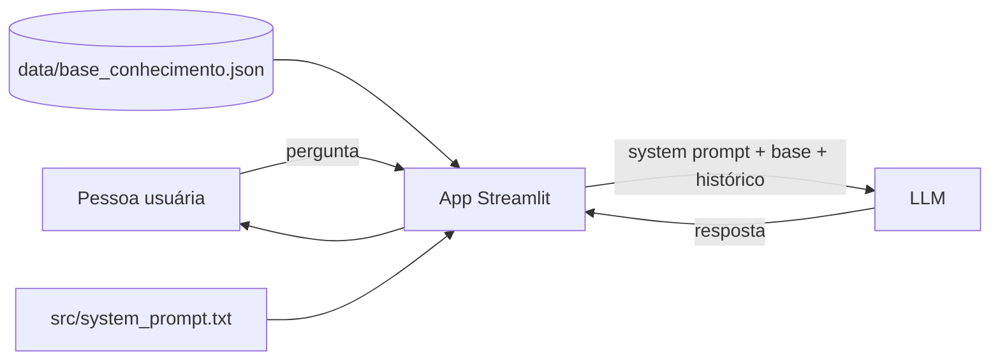

# 01 — Documentação do Agente

## Caso de uso

**PyTutor** é um assistente virtual para **pessoas iniciantes em Python**. Ele resolve o problema de dúvidas básicas de programação que aparecem nos primeiros contatos com a linguagem: erros de sintaxe, uso de listas e dicionários, funções, instalação de bibliotecas.

Por que não usar uma IA genérica? Porque quem está começando não consegue distinguir uma resposta correta de uma **invenção**. O PyTutor responde apenas com base numa base de conhecimento curada e admite quando não sabe.

✏️ **Personalize:** descreva aqui o público específico que você tem em mente (colegas de curso, participantes de bootcamp, você mesmo).

## Problema

- Dúvidas básicas se repetem e atrasam o aprendizado.
- IAs genéricas às vezes inventam funções e comportamentos — o iniciante não percebe.
- Material de estudo é extenso; falta uma resposta direta e específica.

## Para quem

- Pessoas começando em Python (zero a três meses).
- Estudantes de bootcamps e cursos online.

## Persona e tom de voz

| Atributo | Definição |
|----------|-----------|
| Nome | PyTutor 🐍 |
| Tom | Amigável, direto, sem jargão desnecessário |
| Idioma | Português do Brasil |
| Estilo | Resposta curta + exemplo de código + próximo passo |
| Limite | Só fala de Python; admite quando não sabe |

## Escopo

**Cobre (na base atual):** variáveis e tipos, strings/f-strings, listas, dicionários, condicionais, laços, funções, entrada e saída, erros e exceções, módulos e imports, ambiente virtual e pip.

**Não cobre:** orientação a objetos, bibliotecas de terceiros (pandas, Django…), projetos completos, outros assuntos fora de Python.

## Arquitetura

Fluxo: o app carrega a base e o system prompt, monta o contexto e envia para a LLM junto com o histórico da conversa. A resposta volta pelo chat do Streamlit.

✏️ **Personalize:** faça seu próprio diagrama em [Mermaid](https://mermaid.live) se mudar a arquitetura.

## Segurança e anti-alucinação

1. **Regra no prompt:** responder somente com base no contexto fornecido.
2. **Admissão explícita:** quando a resposta não está na base, o agente diz que não sabe e indica a documentação oficial.
3. **Temperatura baixa (0.2):** reduz respostas criativas fora do contexto.
4. **Base pequena e verificável:** 11 tópicos revisáveis manualmente, validados pelo script `src/verificar_base.py`.
5. **Transparência:** a sidebar do app lista os tópicos cobertos — a pessoa sabe o que esperar.

✏️ **Personalize:** registre os resultados reais dos seus testes na [Avaliação](04-metricas.md).
